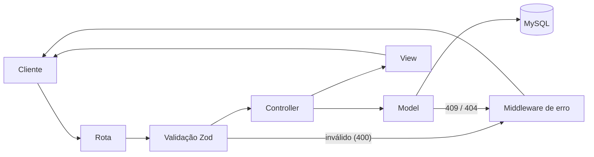

# Agendamento API

API REST para gerenciamento de agendamentos médicos: criação, listagem com filtros e cancelamento. O sistema impede que um mesmo médico tenha dois atendimentos ativos no mesmo horário, inclusive sob requisições concorrentes.

## Sumário

- [Stack](#stack)
- [Justificativa das tecnologias](#justificativa-das-tecnologias)
- [Estrutura do projeto](#estrutura-do-projeto)
- [Requisitos](#requisitos)
- [Execução](#execução)
- [Variáveis de ambiente](#variáveis-de-ambiente)
- [Scripts](#scripts)
- [Testes](#testes)
- [Referência da API](#referência-da-api)
- [Regras de negócio](#regras-de-negócio)
- [Troubleshooting](#troubleshooting)

## Stack

| Tecnologia         | Versão | Papel                                                                         |
| ------------------ | ------ | ----------------------------------------------------------------------------- |
| Node.js            | 20+    | Runtime                                                                       |
| TypeScript         | 7      | Tipagem estática; compilado de `src/` para `dist/`                            |
| Express            | 5      | Servidor HTTP, roteamento e middlewares; serve a página de teste em `public/` |
| MySQL              | 8+     | Persistência e garantia de unicidade de horário                               |
| mysql2             | 3      | Driver MySQL com pool de conexões e queries parametrizadas                    |
| Zod                | 4      | Validação de body, query string e parâmetros de rota                          |
| helmet / cors      | 8 / 2  | Cabeçalhos de segurança e CORS                                                |
| dotenv             | 18     | Carregamento de configuração a partir do `.env`                               |
| tsx                | 4      | Execução de TypeScript em desenvolvimento, com watch                          |
| Vitest + Supertest | 5 / 7  | Testes de integração HTTP                                                     |

## Justificativa das tecnologias

**Node.js e TypeScript** foram adotados conforme a recomendação do desafio. O TypeScript em modo `strict` tipa o contrato entre as camadas (entrada validada, registro do banco e resposta), o que reduz erros de integração entre controller, model e view.

As demais escolhas complementam essa base:

**Express.** Framework HTTP minimalista e amplamente adotado no ecossistema Node. Não impõe estrutura, o que permitiu organizar o projeto em MVC (`routes`, `controllers`, `models`, `views`) com poucas camadas de abstração. O próprio Express também serve os arquivos estáticos da página de teste, sem necessidade de outro servidor.

**MySQL.** Banco relacional escolhido porque a principal regra do domínio, que impede dois agendamentos ativos para o mesmo médico no mesmo horário, pode ser garantida pelo próprio banco. Uma checagem na aplicação ("existe agendamento?" seguida de `INSERT`) está sujeita a condição de corrida. Por isso, a tabela possui a coluna gerada `slot_ativo` com índice `UNIQUE` ([`schema.sql`](database/schema.sql)): ela só é preenchida quando o status é `ATIVO`, de modo que o MySQL rejeita o segundo agendamento mesmo sob concorrência, e os cancelados liberam o horário automaticamente.

**mysql2, sem ORM.** O modelo de dados é uma única tabela, e a regra central depende de recursos específicos do MySQL (coluna gerada e índice único). O SQL escrito diretamente com queries parametrizadas deixa esse comportamento explícito e evita a configuração e a abstração de um ORM. O driver oferece pool de conexões e API baseada em `Promise`.

**Zod.** Validação declarativa com inferência de tipos para o TypeScript. Um único middleware ([`validate.middleware.ts`](src/middlewares/validate.middleware.ts)) aplica o schema de cada rota sobre `body`, `query` e `params`, já com transformações (por exemplo, converter `AAAA-MM-DD` em início e fim do dia no fuso de Brasília) e mensagens em português.

**helmet e cors.** O `helmet` aplica cabeçalhos HTTP de segurança com configuração padrão segura; o `cors` permite que a API seja consumida por front-ends hospedados em outra origem.

**dotenv.** Mantém credenciais e configurações fora do código, carregadas do `.env`, que não é versionado.

**tsx.** Executa TypeScript diretamente em desenvolvimento, com recarga automática, sem etapa de build. A compilação com `tsc` fica restrita ao `npm run build`.

**Vitest e Supertest.** O Vitest tem suporte nativo a TypeScript e ESM, sem configuração adicional de transpilação. O Supertest dispara requisições HTTP contra a instância do Express sem subir o servidor. Os testes rodam contra um MySQL real, em um banco isolado (`agendamento_test`), para que a constraint de unicidade também seja validada.

## Estrutura do projeto

```text
database/schema.sql        Definição da tabela agendamentos
public/                    Página de teste (HTML, CSS, JS)
src/
  config/                  env, pool MySQL e script de migrate
  routes/                  Declaração dos endpoints
  validators/              Schemas Zod
  middlewares/             Validação e tratamento de erros
  controllers/             Orquestração das requisições
  models/                  Acesso a dados (SQL)
  views/                   Serialização das respostas
  errors/                  AppError
  utils/                   Cálculo de início/fim de dia no fuso de São Paulo
  app.ts                   Configuração do Express
  server.ts                Ponto de entrada
tests/                     Testes de integração e globalSetup
```



## Requisitos

- Node.js 20 ou superior, com npm
- MySQL 8 ou superior em execução, com um usuário que tenha permissão para criar bancos de dados

## Execução

```bash
git clone https://github.com/Diegoh-dev/agendamento.git
cd agendamento
npm install
cp .env.example .env   # PowerShell: Copy-Item .env.example .env
npm run db:migrate
npm run dev
```

Antes de rodar o `db:migrate`, ajuste `DB_USER` e `DB_PASSWORD` no `.env` com as credenciais do MySQL local. O migrate cria o banco, caso ele não exista, aplica `database/schema.sql` e pode ser executado mais de uma vez sem perda de dados.

Com o servidor no ar (`Server running on http://localhost:3000`):

- `http://localhost:3000/api/health` responde `{"status":"ok"}`
- `http://localhost:3000/` abre a página de teste da API

## Variáveis de ambiente

| Variável      | Descrição                      | Padrão        |
| ------------- | ------------------------------ | ------------- |
| `PORT`        | Porta HTTP da API              |
| `DB_HOST`     | Host do MySQL                  |
| `DB_PORT`     | Porta do MySQL                 |
| `DB_USER`     | Usuário do MySQL               |
| `DB_PASSWORD` | Senha do usuário               |
| `DB_NAME`     | Banco utilizado pela aplicação | `agendamento` |

O `.env` está no `.gitignore`; o modelo versionado é o [`.env.example`](.env.example).

## Scripts

| Script               | Descrição                                   |
| -------------------- | ------------------------------------------- |
| `npm run dev`        | Inicia a API com `tsx watch`                |
| `npm run db:migrate` | Cria o banco e aplica o schema              |
| `npm test`           | Executa a suíte de testes uma vez           |
| `npm run test:watch` | Executa os testes em modo watch             |
| `npm run build`      | Compila para `dist/`                        |
| `npm start`          | Executa a versão compilada (requer `build`) |

## Testes

```bash
npm test
```

- Usa as credenciais do `.env`, mas sobre o banco `agendamento_test`, criado e migrado automaticamente antes da suíte.
- Não depende do servidor em execução: os testes usam a instância do Express diretamente via Supertest.
- Os arquivos de teste rodam em sequência (`fileParallelism: false`) para evitar interferência entre eles no banco compartilhado.

## Referência da API

URL base: `http://localhost:3000/api`

### Recurso

```json
{
  "id": "3f6c2a1e-8b4d-4c1a-9f2e-7d5b6a4c3e21",
  "patientName": "Ana Silva",
  "doctorName": "Dr. Souza",
  "scheduledAt": "2030-01-15T14:00:00.000Z",
  "status": "ACTIVE"
}
```

`status` assume `ACTIVE` ou `CANCELLED`, e `scheduledAt` é sempre devolvido em UTC.

### Erros

```json
{
  "error": { "message": "O agendamento não pode ser no passado", "status": 400 }
}
```

| Status | Situação                                                                 |
| ------ | ------------------------------------------------------------------------ |
| `400`  | Payload, query ou parâmetro inválido, data no passado ou JSON malformado |
| `404`  | Agendamento inexistente                                                  |
| `409`  | Médico já possui agendamento ativo no horário                            |
| `500`  | Erro interno                                                             |

### `GET /health`

Verificação de disponibilidade. Responde `200` com `{ "status": "ok" }`.

### `POST /appointments`

Cria um agendamento.

| Campo         | Tipo                         | Descrição                                                        |
| ------------- | ---------------------------- | ---------------------------------------------------------------- |
| `patientName` | string, obrigatório          | Nome do paciente                                                 |
| `doctorName`  | string, obrigatório          | Nome do médico                                                   |
| `scheduledAt` | string ISO 8601, obrigatório | Data e hora com `Z` ou offset (ex.: `2030-01-15T11:00:00-03:00`) |

```bash
curl -X POST http://localhost:3000/api/appointments \
  -H "Content-Type: application/json" \
  -d '{"patientName":"Ana Silva","doctorName":"Dr. Souza","scheduledAt":"2030-01-15T11:00:00-03:00"}'
```

Responde `201` com o recurso criado. Pode responder `400` (campo ausente, formato de data inválido ou data no passado) ou `409` (conflito de horário).

### `GET /appointments`

Lista agendamentos ordenados por `scheduledAt`, incluindo ativos e cancelados.

| Query     | Descrição                                             |
| --------- | ----------------------------------------------------- |
| `doctor`  | Nome exato do médico                                  |
| `patient` | Nome exato do paciente                                |
| `from`    | Início do período (`AAAA-MM-DD` ou ISO 8601 com fuso) |
| `to`      | Fim do período (`AAAA-MM-DD` ou ISO 8601 com fuso)    |

Semântica do período:

- Com `from` e `to`, o intervalo é inclusivo. Uma data sem hora equivale a 00:00:00.000 em `from` e a 23:59:59.999 em `to`, no horário de Brasília.
- Com apenas um dos dois, o filtro cobre aquele dia inteiro (se for só data) ou aquele instante exato (se tiver hora).
- `from` posterior a `to` resulta em `400`.

```bash
curl "http://localhost:3000/api/appointments?doctor=Dr.%20Souza&from=2030-01-01&to=2030-01-31"
```

Responde `200` com um array de recursos, possivelmente vazio. Pode responder `400` (filtro vazio ou data inválida).

### `PATCH /appointments/:id/cancel`

Cancela um agendamento.

```bash
curl -X PATCH http://localhost:3000/api/appointments/3f6c2a1e-8b4d-4c1a-9f2e-7d5b6a4c3e21/cancel
```

Responde `200` com o recurso e `status: "CANCELLED"`; a operação é idempotente. Pode responder `400` (o `id` não é UUID) ou `404` (agendamento inexistente).

## Regras de negócio

- Datas inválidas, sem fuso ou no passado são recusadas com `400`.
- Um médico não pode ter dois agendamentos ativos no mesmo horário; a segunda tentativa recebe `409`.
- O cancelamento libera o horário para um novo agendamento.
- Agendamentos não são removidos; o cancelamento é lógico.
- A resposta expõe somente `id`, `patientName`, `doctorName`, `scheduledAt` e `status`.

## Troubleshooting

| Erro                     | Causa provável                                  |
| ------------------------ | ----------------------------------------------- |
| `ECONNREFUSED`           | MySQL parado, ou `DB_HOST`/`DB_PORT` incorretos |
| `ER_ACCESS_DENIED_ERROR` | `DB_USER`/`DB_PASSWORD` incorretos no `.env`    |
| `EADDRINUSE`             | Porta definida em `PORT` já está em uso         |
